# Лабораторная П03. Работа с Git

## Задание
Создать репозиторий на GitHub, создать локальный репозиторий и внести изменения, отправить их на сервер, отработать разрешение конфликта слияния, поработать с ветками. Использованы команды `git clone/pull/add/commit/push`.

## Окружение
- Ubuntu Server 24.04 (arm64) в VirtualBox, хост: macOS (Apple Silicon)
- Git, подключение к GitHub по SSH
- Основная ветка: `main`

## 1. Настройка git
Заданы имя и почта пользователя, имя основной ветки `main` и стратегия слияния при `git pull`.

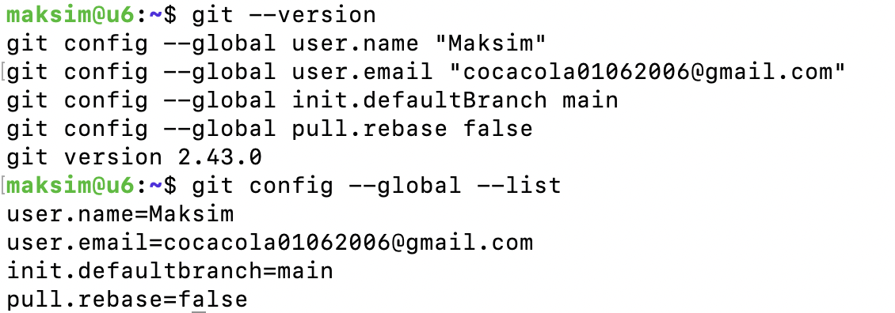

## 2. Локальный репозиторий
Создан каталог `devops_lab3`, выполнен `git init`, создан `README.md` и зафиксирован первый коммит.

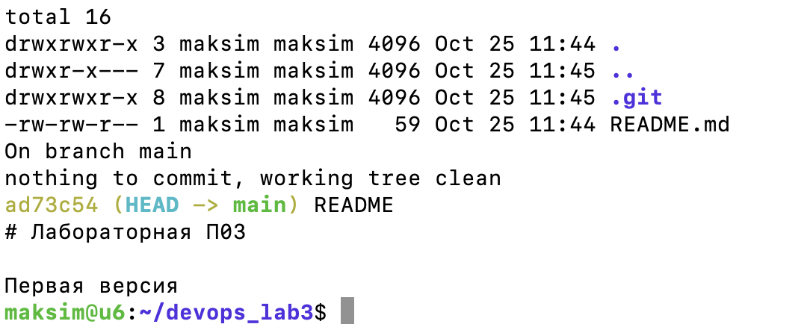

## 3. SSH-ключ для GitHub
На VM использован ключ ed25519. Публичная часть (`id_ed25519.pub`) добавлена в профиль GitHub (Settings → SSH and GPG keys). Проверка `ssh -T git@github.com` подтвердила аутентификацию. Приватный ключ нигде не публиковался.

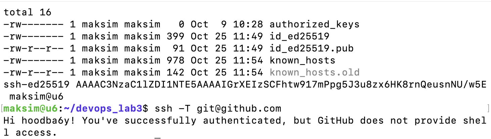

## 4. Подключение удалённого репозитория и первый push
На GitHub создан пустой репозиторий (без README и лицензии). Он привязан командой `git remote add origin`, затем выполнен `git push -u origin main`.

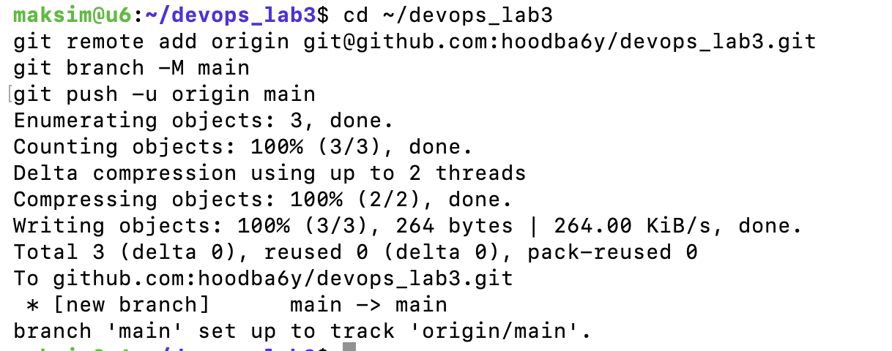

Файл появился на сервере:

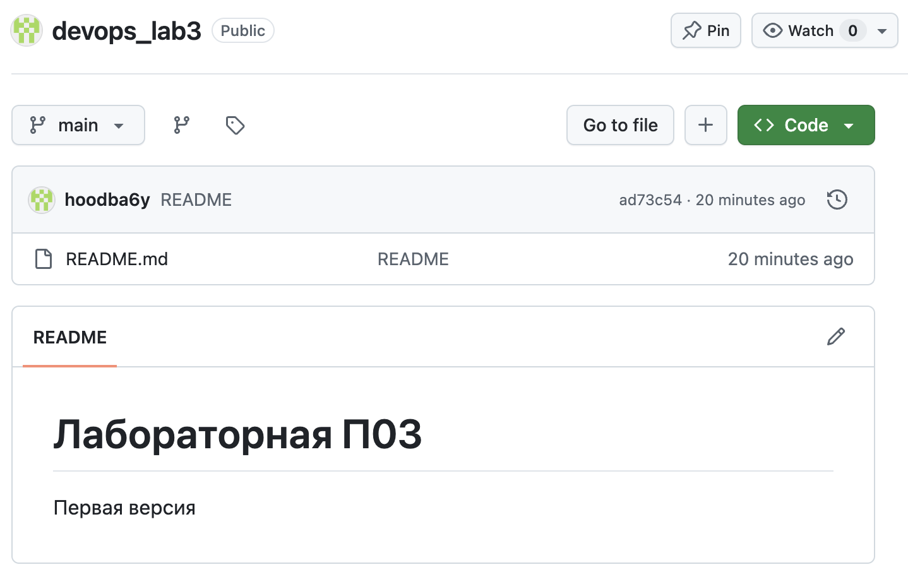

## 5. Конфликт слияния
**Создание конфликта.** Первая строка `README.md` была изменена локально (коммит «Локальная правка») и независимо в веб-редакторе GitHub (коммит «Update project title»).

**Отказ сервера.** Попытка `git push` была отклонена, так как на сервере есть коммит, которого нет локально.

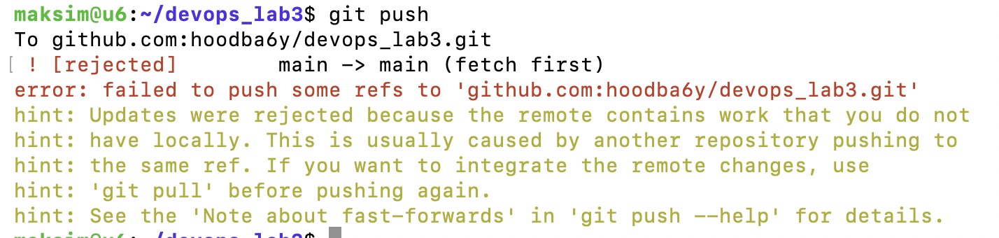

**Pull.** `git pull` подтянул изменения, но объединить их автоматически не смог: `CONFLICT (content): Merge conflict in README.md`.

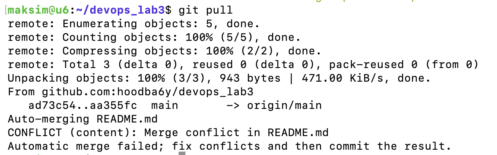

**Анализ.** `git status` показывает `both modified: README.md`. В файле появились маркеры `<<<<<<< HEAD`, `=======`, `>>>>>>>` с обеими версиями строки.

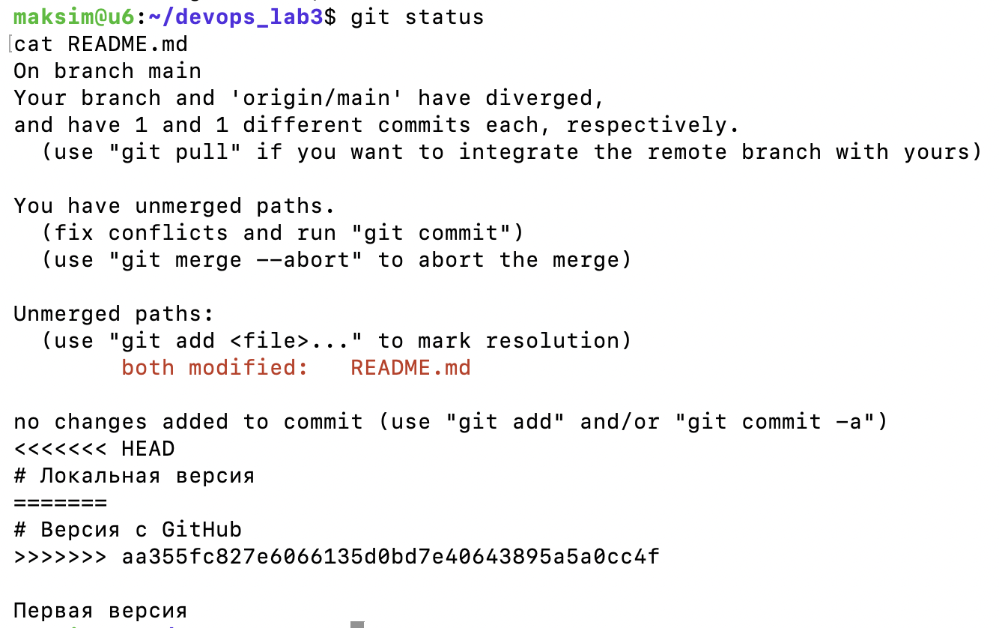

**Разрешение.** Файл открыт в редакторе, маркеры удалены, строка приведена к итоговому виду, учитывающему обе версии.

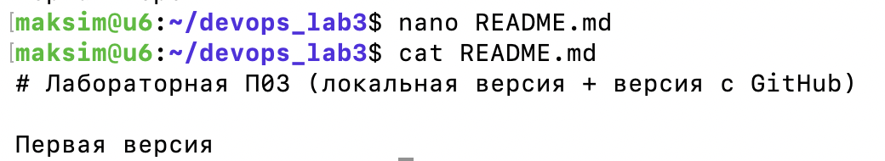

Исправление зафиксировано командами `git add README.md` и `git commit`, затем выполнен `git push`. В графе истории видно, что две линии коммитов сошлись в коммите слияния.

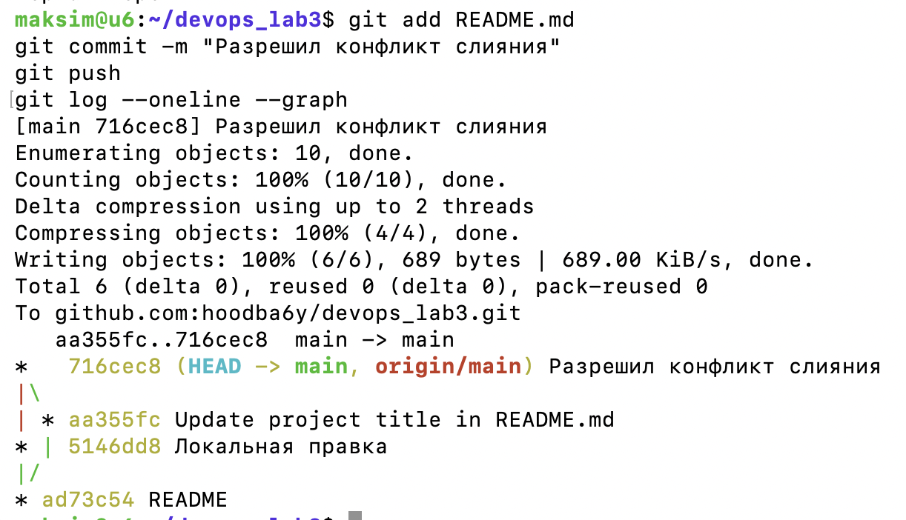

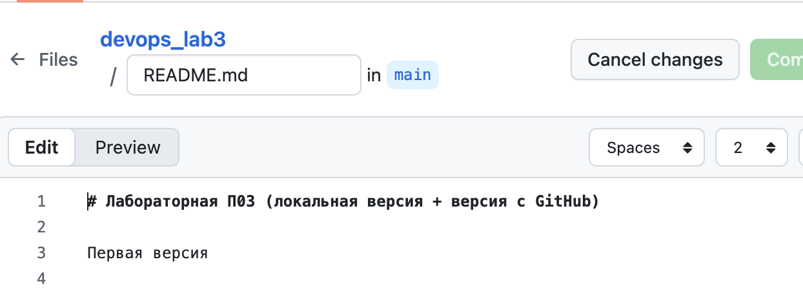

## 6. Работа с ветками
Создана ветка `FEAT-123` (`git checkout -b FEAT-123`), в файл добавлена строка, изменения зафиксированы и отправлены с созданием одноимённой ветки на сервере (`git push -u origin FEAT-123`).

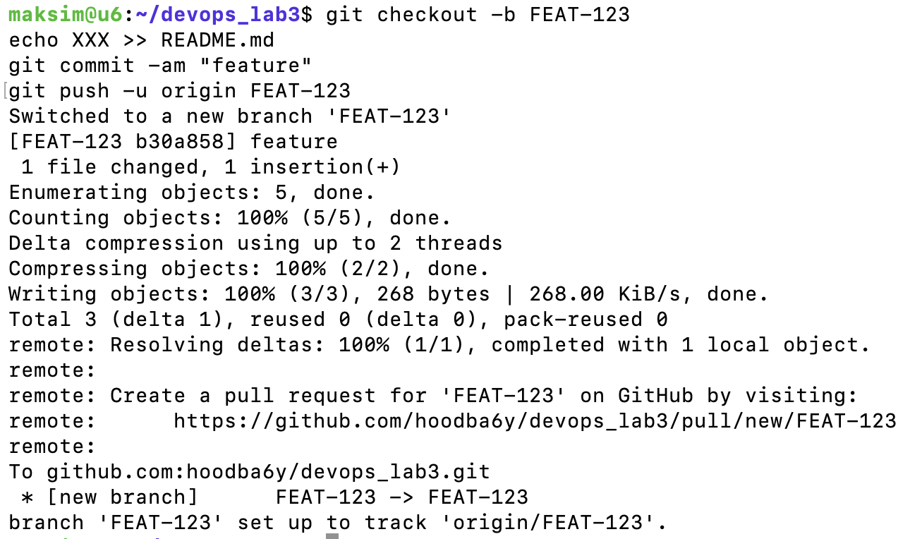

На GitHub видны обе ветки:

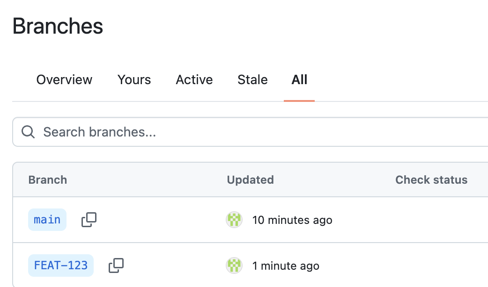

Затем выполнено переключение на `main` и слияние `git merge FEAT-123`. Слияние прошло в режиме fast-forward (без отдельного коммита слияния), потому что в `main` после создания ветки не было новых коммитов. После `git push` ветки `main`, `origin/main` и `FEAT-123` указывают на один коммит.

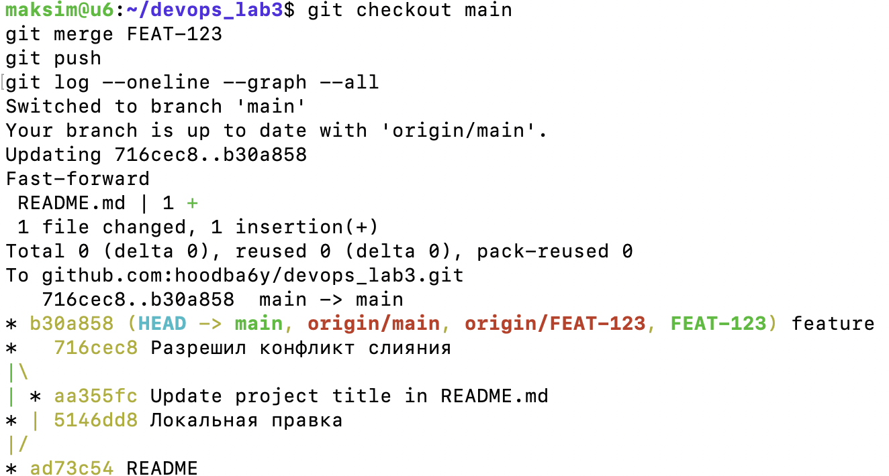

## Использованные команды
```bash
git config --global user.name "..."
git config --global user.email "..."
git init
git add README.md
git commit -m "README"
ssh-keygen
ssh -T git@github.com
git remote add origin git@github.com:hoodba6y/devops_lab3.git
git branch -M main
git push -u origin main
git pull
git status
git add README.md
git commit -m "Разрешил конфликт слияния"
git push
git checkout -b FEAT-123
git commit -am "feature"
git push -u origin FEAT-123
git checkout main
git merge FEAT-123
git log --oneline --graph --all
```

## Выводы
Освоен базовый цикл работы с Git и GitHub: создание репозитория, подключение удалённого репозитория по SSH, отправка и получение изменений. Воспроизведён и разрешён конфликт слияния. Выполнена работа с ветками и слияние.
